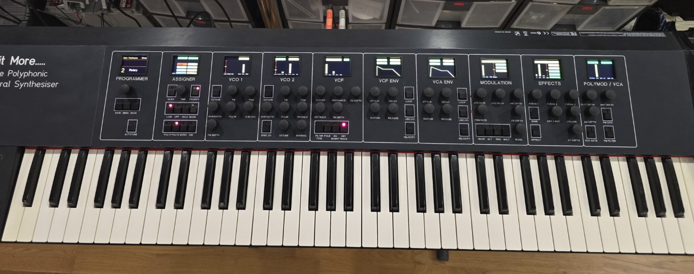

## So this is a rebuild of the "A Bit More" the 8 voice polyphonic analogue synth.

## A new synth is born with a modified controller, same displays but with new self contained voice boards, and the LFO's have moved to the RP2350 in software and each RP2350 autotunes a pair of AS3340 VCO's

This is an 12 voice bi-timbral polyphonic dual VCO based synthesizer that uses an RP2350 to autotune and control a pair of AS3340 VCO chips.

I have also added portamento, octave switching, oscillator sync etc.

Filters are based on the Matrix 12 pole switching filters with 16 filter types available, dual LFO's are available for modulation and PWM, plus a white/pink noise source.

The case and keybed are a CME UF-70 Classic (black) and I've only kept the main MIDI board and grounded the pots/slider inputs.

# It utilizes the following projects

https://github.com/craigyjp/Dual-AS3340-oscillator-core-with-Autotune

https://github.com/craigyjp/Voice_board_analogue_6_channel

https://github.com/craigyjp/A_Bit_More/tree/main/Displays

# Things to fix 

* Add sustain from pedal A (CC 64).
